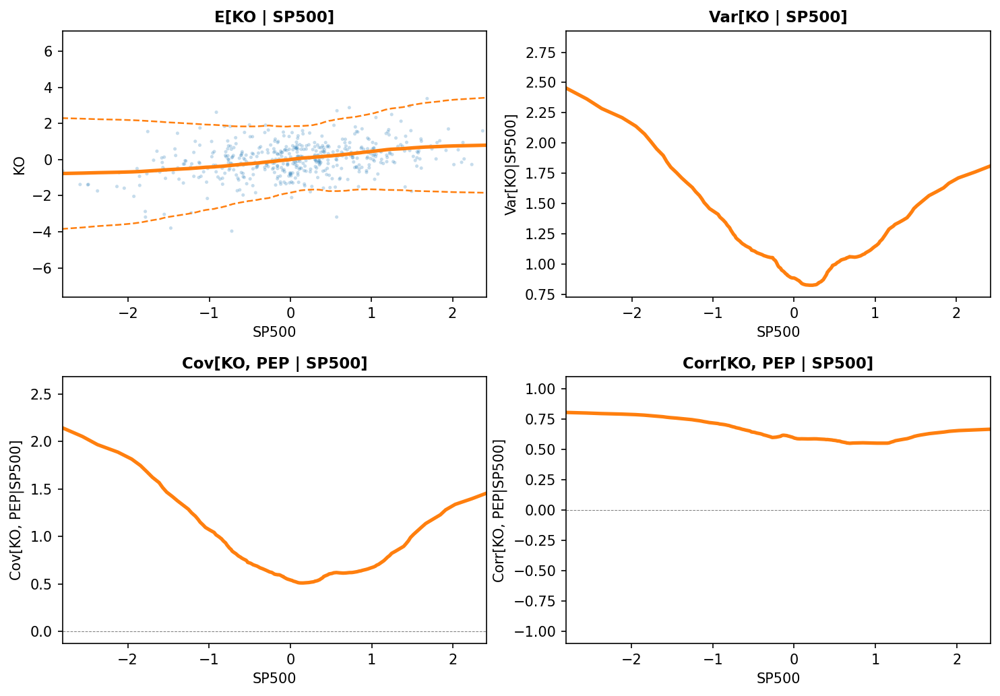

[](https://pypi.org/project/kernelmoments/)
[](https://pypi.org/project/kernelmoments/)
[](https://opensource.org/licenses/MIT)
[](https://numpy.org/)
[](https://cupy.dev/)

# kernelmoments

Estimate and visualize conditional moments — means, variances, covariances, and correlations — using adaptive kernel regression. Built on [kernelboost](https://github.com/tlaiho/kernelboost)'s `KernelTree`, which partitions data and fits local Nadaraya-Watson estimators with automatic bandwidth selection.

Designed for interactive data exploration. Computationally fast for a kernel method: subsecond fitting with CPU for 5-10k rows and with GPU for 25-50k rows. See the [tutorial](examples/tutorial.ipynb) and the [wages example](examples/wages.ipynb) on how to use the package.



## Installation

```bash
pip install kernelmoments
```

For GPU acceleration, also install the CuPy wheel matching your CUDA version:

```bash
pip install kernelmoments cupy-cuda13x   # or cupy-cuda12x
```

## Quick start

### Plot from NumPy arrays with `plot_relationship`

```python
from kernelmoments import plot_relationship

# Conditional mean with +-1.96*sqrt(Var) prediction bands
result = plot_relationship(x, y, moment="mean", bands=True)

# Conditional variance
result = plot_relationship(x, y, moment="variance")

# Conditional correlation between y and z given x
result = plot_relationship(x, y, z=z, moment="correlation")
```

### Plot from DataFrames with `Plotter`

```python
from kernelmoments import Plotter

p = Plotter(df, n_sample=5000)  # optional subsampling for faster fitting
p.fit(x="age", y="income", z="spending")  # pre-fit all moments

p.plot(x="age", y="income")                              # conditional mean
p.plot(x="age", y="income", moment="variance")            # conditional variance
p.plot(x="age", y="income", z="spending", moment="correlation")  # conditional correlation
```

Scaling data beforehand is a good idea for kernel methods. `Plotter` takes an `x_scaler` argument, which it uses to fit in scaled units and plot in original units. scikit-learn scalers work, as does `RankTransformer` (re-exported from `kernelboost` as `kernelmoments.RankTransformer`), which is used in the examples.


### Estimators directly

```python
from kernelmoments import MeanEstimator, VarianceEstimator, CovarianceEstimator

mean_est = MeanEstimator().fit(X, y)
y_hat = mean_est.predict(X_new)

var_est = VarianceEstimator().fit(X, y)
var_hat = var_est.predict(X_new)

cov_est = CovarianceEstimator().fit(X, y, z)
cov_hat = cov_est.predict(X_new)
cov_est.fit_correlation()
corr_hat = cov_est.predict_correlation(X_new)
```

All estimators follow the scikit-learn `fit` / `predict` pattern. Constructor parameters (bandwidth bounds, kernel type, tree depth, etc.) are forwarded to `KernelTree`.

## References

Fan, J., & Yao, Q. (1998). Efficient estimation of conditional variance functions in stochastic regression. Biometrika, 85(3), 645–660.

Nadaraya, E. A. (1964). On Estimating Regression. Theory of Probability and Its Applications, 9(1), 141-142.

Watson, G. S. (1964). Smooth Regression Analysis. Sankhyā: The Indian Journal of Statistics, Series A, 26(4), 359-372.

Yin, J., Geng, Z., Li, R., & Wang, H. (2010). Nonparametric covariance model. Statistica Sinica, 20, 469.

## License

MIT
